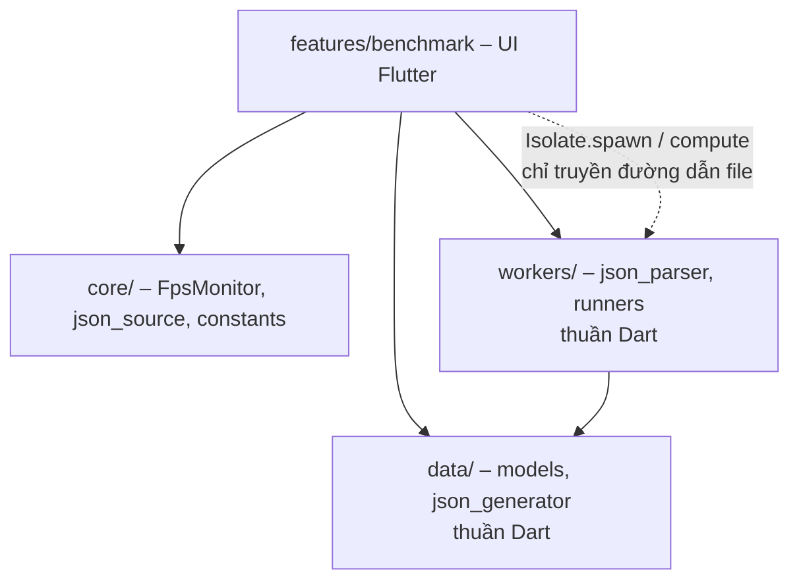
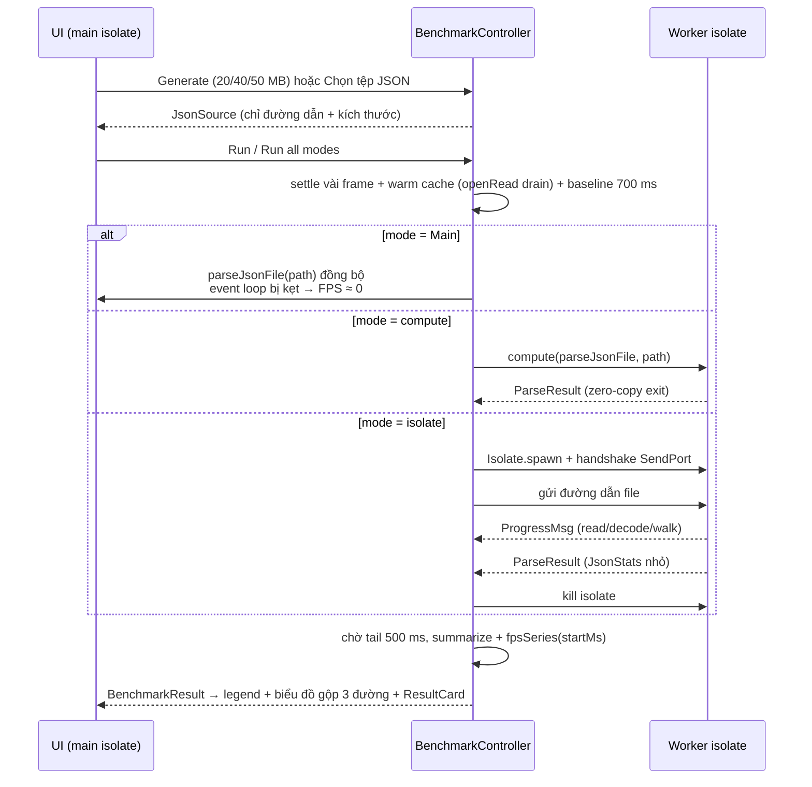

# Kiến trúc hệ thống & luồng dữ liệu

> Biên soạn lại từ Chương 3–4 của báo cáo đề tài, cập nhật theo
> `AGENT_CHANGES.md` (đơn giản hóa: một màn hình, parser tổng quát, biểu đồ
> gộp 3 chế độ).

## 1. Kiến trúc phân tầng



Nguyên tắc then chốt: tầng `workers/` và `data/` **thuần Dart** (không
import `package:flutter/*`) để hàm parse chạy được trong isolate. Ngoại lệ
duy nhất: `runners.dart` import `package:flutter/foundation.dart` vì cần
hàm `compute` (và `material.dart` cho màu của `RunMode` – chỉ dùng ở UI).

## 2. Cây thư mục

```
lib/
├── main.dart                 # runApp
├── app.dart                  # dark theme, home: BenchmarkScreen
├── core/
│   ├── constants.dart        # ngân sách 16.67 ms, size 20/40/50 MB
│   ├── fps_monitor.dart      # Ticker + frames + fpsSeries(200 ms bins)
│   └── json_source.dart      # generateSource(), pickSource() (file_picker)
├── data/
│   ├── json_generator.dart   # sinh JSON (streaming, seed 42, isolate)
│   └── models/
│       ├── parse_result.dart # JsonStats, ParseResult, ProgressMsg
│       └── benchmark_result.dart  # + series (đường biểu đồ)
├── workers/                  # thuần Dart
│   ├── json_parser.dart      # parseJsonFile() – parser tổng quát, dùng chung
│   ├── runners.dart          # RunMode + runOnMain + runWithCompute
│   └── isolate_runner.dart   # runWithIsolate (handshake SendPort/ReceivePort)
└── features/benchmark/
    ├── benchmark_screen.dart
    ├── benchmark_controller.dart
    └── widgets/ (fps_gauge, jank_animation, result_card, fps_chart)
```

## 3. Luồng dữ liệu tổng quan



## 4. Ba nhánh thực thi – so sánh

| Chế độ | Dòng dữ liệu | Tác động lên UI |
|---|---|---|
| Main thread | Đọc file → `jsonDecode` → `_walk` trên UI isolate | Event loop kẹt toàn bộ thời gian ⇒ FPS ≈ 0 |
| compute() | Gửi **đường dẫn** → isolate tạm parse → trả `ParseResult` bằng exit | UI chỉ trả giá spawn + nhận kết quả (vài ms) |
| Isolate.spawn + Port | Handshake → gửi đường dẫn → `ProgressMsg` định kỳ → `ParseResult` → kill | UI mượt, có progress bar |

**Parser tổng quát:** `parseJsonFile` nhận **bất kỳ** JSON hợp lệ (gốc
object/array/scalar), không phụ thuộc schema. Kết quả là `JsonStats`
(topLevel, nodes, maxDepth) – nhỏ, rẻ khi gửi qua port.

**Nguyên tắc công bằng:** chỉ truyền đường dẫn tệp vào isolate; cả ba
chế độ gọi **cùng** `parseJsonFile`; trước mỗi lần chạy, controller warm
cache hệ điều bằng đọc file bất đồng bộ (`openRead().drain()`) để chế độ
đo đầu tiên không bị bất lợi do đọc lạnh.

## 5. Biểu đồ gộp & thuật toán đo FPS

`FpsMonitor` dùng `Ticker` + `Stopwatch`. Khi UI bị chặn, tick không đến;
tick kế tiếp có khoảng cách rất lớn – chính là dấu hiệu đứng hình.

Biểu đồ vẽ **kết quả mới nhất của mỗi chế độ** (tối đa 3 đường) trên cùng
trục, X căn theo **mốc bắt đầu tác vụ = 0 s**. Chuỗi FPS được lấy theo
**ô 200 ms dạng bậc thang**: mỗi ô đầy đủ → một đoạn ngang (2 điểm cùng
giá trị), ô cuối chưa đủ 200 ms bị bỏ. Ô không có frame nào → 0 FPS ⇒
đường Main tụt về 0 **thẳng đứng** đúng bằng thời gian đứng hình, không
có cạnh xiên và không rơi xuống ở mép phải.

Trục Y: FPS, cố định 0–65, nhãn `0, 15, 30, 45, 60`, đường tham chiếu
nét đứt tại 60 và 30 (giả định màn hình 60 Hz). Trục X: giây, nhãn mỗi
0,5 s với 1 chữ số thập phân, vạch nét đứt tại 0 ghi `start`.

| Đại lượng | Công thức |
|---|---|
| Khoảng frame | `Δi = ti − ti−1` (ms) |
| FPS ô 200 ms | số frame trong ô × 1000 / 200; không có frame → 0 |
| FPS trung bình (trong tác vụ) | `N × 1000 / Σ Δi` với frame **giao** `[start, end]` |
| Frame dài nhất | `max Δi`; FPS thấp nhất tức thời = `1000 / max Δi` |
| Vsync bỏ lỡ | `Σ max(0, ⌊Δi / 16,67⌋ − 1)` |

**Lưu ý cài đặt quan trọng:**

1. Frame "đứng hình" chỉ được ghi **sau** khi tác vụ kết thúc → đợi
   `tailMs` rồi mới tổng hợp.
2. Quy tắc **giao khoảng**: frame `(ti − Δi, ti]` thuộc tác vụ nếu giao
   với `[start, end]`.
3. Trước khi chạy Main phải `await endOfFrame` vài lần để UI kịp vẽ trạng
   thái "đang chạy".
4. `JankAnimation` **luôn chạy** để Flutter luôn lên lịch frame.
5. Đo ở `--profile` trên máy thật khi có thể.
